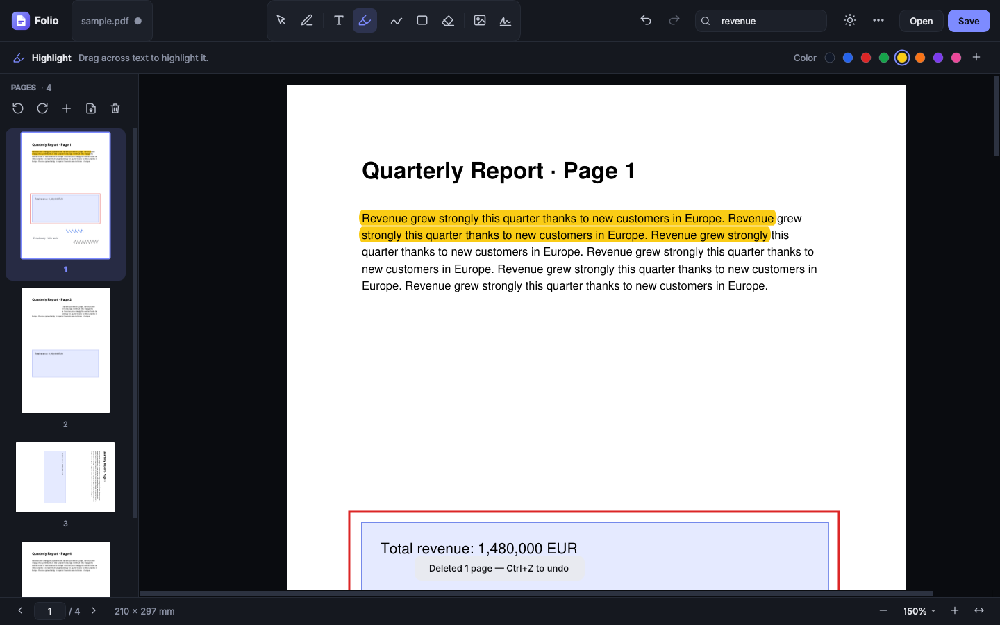

<p align="center"></p>

<p align="center"><b>A modern PDF editor for Linux</b><br>
Built for Zorin OS 18 · works on Ubuntu 24.04 and other distros based on it</p>

---

Folio opens, edits, annotates, signs, merges and reorganises PDF documents, with a clean dark and light
interface. It does the everyday jobs people use Acrobat for: fixing a word, signing a form, combining
scans into one file, removing or reordering pages.

Folio is an independent app. It is not affiliated with or endorsed by Adobe and contains no Adobe code.

<p align="center"></p>

## Install

Download `Folio_<version>_amd64.deb` from the [latest release](../../releases/latest), then:

```bash
cd ~/Downloads
sudo apt install ./Folio_*_amd64.deb
folio
```

Folio then appears in the app menu, and in *Open With* when you right-click a PDF. To make it the
default for PDFs: right-click a PDF ▸ *Open With…* ▸ Folio ▸ turn on *Always use for this file type*, or run
`xdg-mime default folio.desktop application/pdf`.

To update, install the newer `.deb` the same way. To remove: `sudo apt remove folio`.

## Features

**Viewing**: smooth scrolling, zoom (Ctrl + mouse wheel), fit width / fit page, page thumbnails, search
across the document (Ctrl+F, F3 for the next result).

**Editing text**: drag a box over existing text and rewrite it. Folio removes the old words and writes the new
ones at the same position, size and colour in the closest matching font (sans, serif or mono; bold and italic).
Greek, Cyrillic and other scripts are supported.

**Annotating**: add text anywhere, highlight (snaps to whole words), freehand drawing, rectangles, images,
colour palette with a custom colour picker. Right-click an annotation to delete it.

**Signing**: draw your signature once (or use an image of it). It is saved, and after that one click places it.

**Erasing**: permanently remove everything inside a box (text, pictures, drawings), for example to hide
an account number before sharing.

**Pages**: drag thumbnails to reorder, rotate, delete, duplicate, insert blank pages or pages from other files.

**Files**: merge several PDFs (or images) into one, split by page / every N pages / custom ranges,
extract selected pages, compress, protect with a password (AES-256), print. Images, XPS and EPUB open as PDFs.

**Tabs**: every PDF opens as a tab in one window, also when you double-click more PDFs in Files while
Folio is running. Drag tabs to reorder; each tab keeps its own zoom, page and undo history.

**Comfort**: dark and light themes, undo/redo for every change, drag & drop files onto the window
(drop several to merge), recent files.

## Keyboard shortcuts

| Key | Action | Key | Action |
|---|---|---|---|
| V | Select / copy text | Ctrl+O | Open |
| E | Edit text | Ctrl+S / Ctrl+Shift+S | Save / Save as |
| T | Add text | Ctrl+Z / Ctrl+Shift+Z | Undo / Redo |
| H | Highlight | Ctrl+F, F3 | Search, next result |
| D | Draw | Ctrl + / Ctrl − / Ctrl 0 | Zoom in / out / fit width |
| R | Rectangle | Delete | Delete selected pages |
| X | Erase area | Ctrl+P | Print |
| I | Image | Ctrl+W | Close tab |
| S | Signature | Esc | Back to the Select tool |
| Ctrl+Tab | Next tab | Ctrl+Shift+Tab | Previous tab |

## Your data

Folio edits your PDF in memory; nothing changes on disk until you press **Save**. Saving writes to a
temporary file first and then replaces the original, so a crash can't leave a half-written PDF.

| What | Where |
|---|---|
| Your signature | `~/.config/folio/signature.png` |
| Settings (theme, recent files) | `~/.config/Folio/Folio.conf` |

## Good to know

- **Edit text** works line by line: if the new text is much longer than the old, it won't wrap onto the next line by itself.
- PDFs that use unusual embedded fonts are re-written in the closest standard font.
- Scanned PDFs are pictures of text, so they can be annotated and signed but their text can't be edited.

## Build from source

```bash
sudo apt install -y python3-venv libxcb-cursor0
bash packaging/build-deb.sh                     # → dist/Folio_<version>_amd64.deb
sudo apt install ./dist/Folio_*_amd64.deb
```

Run without packaging: `python3 -m venv .venv && .venv/bin/pip install -r requirements.txt && .venv/bin/python folio.py`.
Tech: Python, Qt 6 (PySide6), PyMuPDF (MuPDF).

To release: bump `VERSION` in `folio.py`, add an entry to `CHANGELOG.md` and push to `main`. GitHub Actions builds
the `.deb`, test-installs it and publishes release `vX.Y.Z`.

## Changelog

See [CHANGELOG.md](CHANGELOG.md).

## Licence

[MIT](LICENSE). Folio uses PyMuPDF, which is licensed under the AGPL-3.0, so a packaged Folio binary
is distributed under the AGPL's terms as well.
